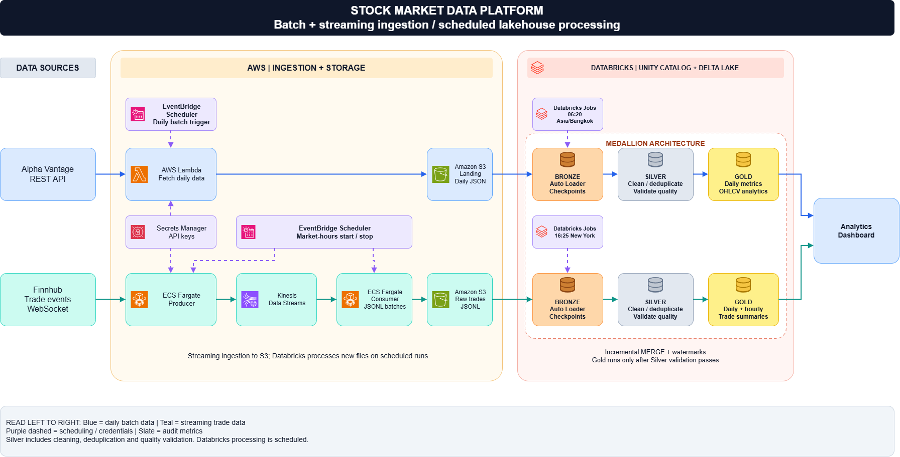
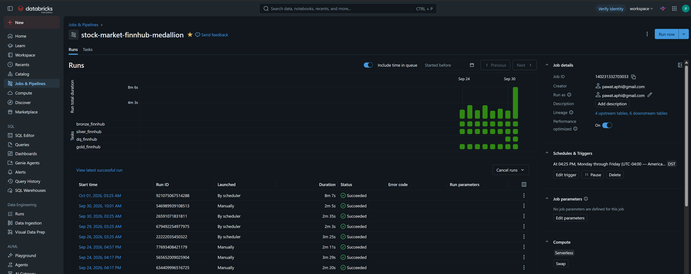
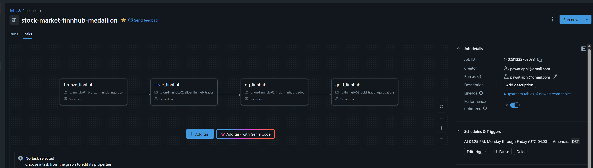
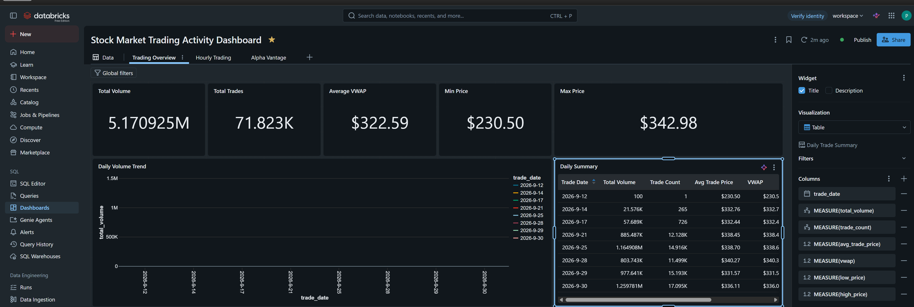

# Stock Market Data Platform

End-to-end data engineering project for ingesting, processing,
and analyzing stock market data using AWS and Databricks.

## Architecture

The platform supports two ingestion patterns:

- Batch ingestion using Alpha Vantage
- Real-time streaming ingestion using Finnhub

Data is ingested into Amazon S3 and processed through a
Bronze → Silver → Gold Medallion Architecture in Databricks.

For a detailed architecture breakdown, see
[Architecture Documentation](docs/architecture.md).

## Screenshots / Demo

### Pipeline Orchestration

### Analytics Dashboard

## Tech Stack

- AWS Lambda
- Amazon EventBridge Scheduler
- Amazon S3
- Amazon Kinesis Data Streams
- Amazon ECS Fargate
- AWS Secrets Manager
- Databricks
- Apache Spark / PySpark
- Delta Lake
- Unity Catalog
- Databricks Jobs
- Databricks SQL / Dashboard
- Python

## Data Pipelines

### Batch Pipeline

EventBridge Scheduler
→ AWS Lambda
→ Alpha Vantage API
→ Amazon S3 Landing
→ Databricks Bronze
→ Silver
→ Gold

### Streaming Pipeline

Control flow:

EventBridge Scheduler
→ Start / Stop ECS Fargate Services

Data flow:

Finnhub WebSocket
→ ECS Fargate Producer
→ Amazon Kinesis
→ ECS Fargate Consumer
→ Amazon S3 Raw
→ Databricks Bronze
→ Silver
→ Gold

## Medallion Architecture

### Bronze

Stores raw or minimally transformed source data.

### Silver

Cleans, normalizes, casts data types, and removes duplicates.

### Gold

Contains aggregated and analytics-ready datasets used by dashboards.

## Incremental Processing

The pipelines use incremental processing to avoid reprocessing
the entire dataset on every run.

Techniques include:

- Databricks Auto Loader
- Checkpoints
- Delta MERGE
- Pipeline watermarks
- Affected-partition recomputation

Finnhub assigns a UUID to each received trade before writing to Kinesis.
Silver uses this `event_id` to distinguish trades that share the same symbol,
price, timestamp, and volume. Historical records without an ID retain their
previous business-key behavior. Finnhub daily and hourly summaries use UTC.
On the first Gold run after this change, the job rebuilds both summaries from
Silver and removes groups created with the previous timezone setting.
Deploy the updated producer first, then run the Bronze, Silver, and Gold jobs
in that order. Auto Loader may restart Bronze once when it discovers the new
`event_id` field. A producer-generated ID identifies a received WebSocket
event; it does not detect a duplicate event delivered again by Finnhub.
Bronze retains the original numeric field values alongside parsed values.
Silver tracks the last successful Bronze Delta version and reads later inserts
through Change Data Feed. Gold uses a Delta lock row while updating daily and
hourly summaries; configure the Databricks Job with a single concurrent run as
well. The lock expires after 24 hours if a run cannot release it.
The one-time Gold rebuild uses `whenNotMatchedBySourceDelete`, which requires
Databricks Runtime 12.2 LTS or newer.

Run the local streaming tests with `python -m unittest discover -s tests -v`.
The Databricks scenarios in [Finnhub validation cases](tests/databricks_finnhub_validation.md)
cover Delta behavior that needs a Databricks workspace.

## Analytics Dashboard

The project includes dashboards for:

- Trading volume
- Trade count
- VWAP
- Stock closing price
- Moving averages
- Daily returns
- Daily volume
- High / low price trends

## Repository Structure

src/
    streaming/
docs/
    architecture.md
    data_dictionary.md
    project_documentation.md

## Future Improvements

Potential future enhancements include:

- Infrastructure as Code
- Additional market data sources
